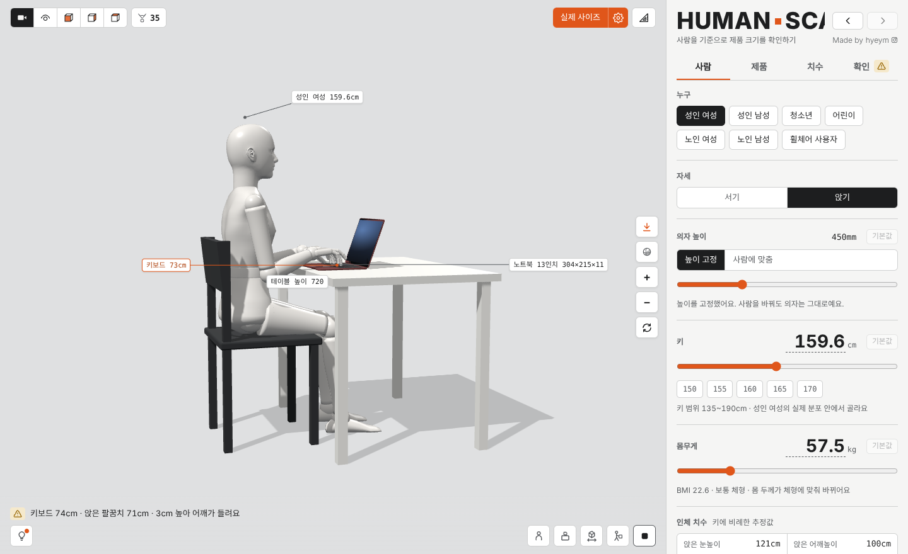
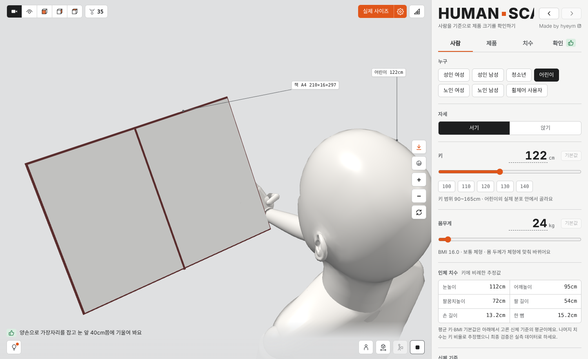
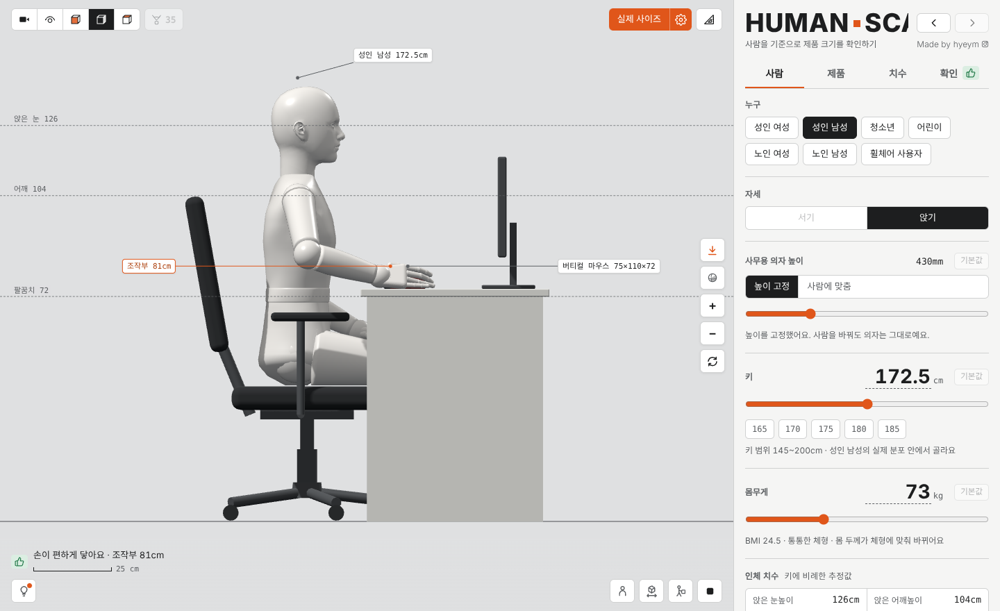
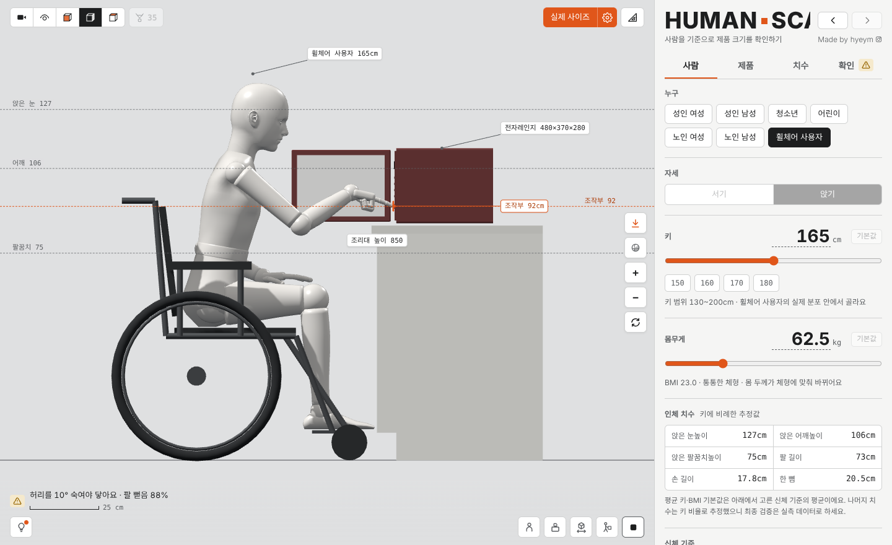
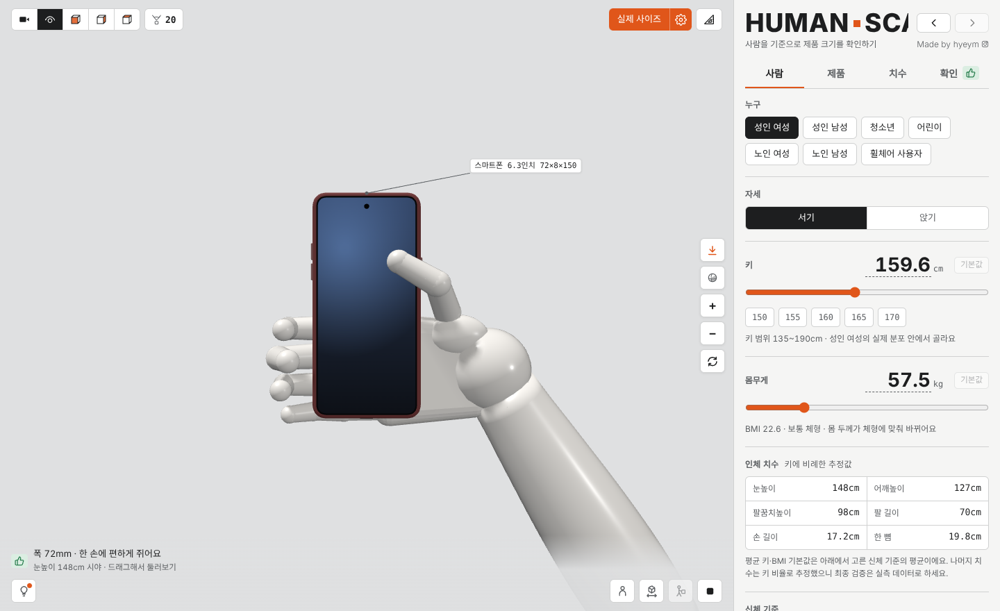

# Human Scale

**사람을 기준으로 제품의 크기를 확인하는 3D 온라인 목업**

사이트: https://haleyhylee.github.io/human-scale/

## 소개

"이 제품은 어느 정도 크기여야 할까?"
산업디자이너가 디자인을 시작하기 전 가장 먼저 부딪히는 질문입니다. 이를 확인하려면 비슷한 제품의 크기와 사람의 신체 치수를 하나하나 찾아보고, 마네킹 3D 파일을 구해 불러와 맞춰 보는 데만 꽤 많은 시간이 걸립니다. 도면 위 숫자만으로는 감이 잘 오지 않고, 실물 목업을 만들기엔 시간과 비용이 듭니다. Human Scale은 이 과정을 한곳에 모아, 스케일 감각을 빠르고 꼼꼼하게 확인하기 위해 만들었습니다.

같은 제품도 사람에 따라 다르게 느껴집니다. 성별과 나이, 체형, 장애 여부에 따라 누군가에게는 손이 닿지 않거나, 쥐기 어렵거나, 불편할 수 있습니다. Human Scale에서는 다양한 사람이 제품을 직접 쥐고, 누르고, 펼쳐 보며, 생길 수 있는 불편함을 미리 짚어 줍니다. 더 많은 사람이 불편 없이 쓸 수 있는 유니버설 디자인을 디자인 초기부터 확인하는 것, 나아가 AI가 이를 점검하고 개선 방향을 먼저 제안하는 것까지 목표로 했습니다.

확인이 끝나면 바로 디자인으로 이어집니다. 사람과 함께 있는 제품을 3D 파일로 내보내면, 크기가 이미 맞춰진 상태에서 곧바로 디자인을 시작할 수 있습니다. 반대로 직접 디자인한 3D 파일을 불러와 사람 옆에 놓아 볼 수도 있습니다.

디자이너가 아니어도 괜찮습니다. 종이 한 장, 수납장 하나처럼 원하는 제품이 있다면, 실물로 만들기 전에 그 크기와 느낌을 미리 확인해 보세요. 종이나 스마트폰에 내 이미지를 입혀 보고, 여러 시점과 사용자의 눈높이인 1인칭 시점으로 둘러볼 수 있습니다.

## 화면

| | |
|---|---|
|  |  |
| 책상에서 노트북 사용 — 높이·거리 점검 | 어린이가 A4 책을 펼쳐 읽는 모습 |
|  |  |
| 버티컬 마우스 쥐기 — 옆에서 본 모습 | 휠체어 사용자의 전자레인지 사용 — 닿는 높이 점검 |
|  | |
| 사용자의 눈으로 본 1인칭 시점 | |

## 할 수 있는 것

- **다양한 사람:** 성인 여성·남성, 청소년, 어린이, 노인, 휠체어 사용자. 실제 신체 치수 자료를 바탕으로, 키와 몸무게(15–200kg)에 따라 체형이 바뀝니다. 마네킹 파일을 따로 구할 필요가 없습니다.
- **제품 크기 예시:** 휴대폰, 노트북, 가전, 가구, 종이 등 자주 쓰는 제품의 실제 크기가 들어 있어 따로 찾아볼 필요가 없습니다.
- **실제 사용 동작:** 쥐기, 누르기, 펼치기, 앉기 같은 동작을 재생해 봅니다.
- **유니버설 디자인 점검:** 손이 닿는지, 한 손으로 쥘 수 있는지, 높이와 거리가 적당한지 다양한 사람 기준으로 바로 알려 줍니다.
- **3D 파일 불러오기·내보내기:** 내 디자인 파일을 불러오고, 사람과 함께 있는 장면을 크기가 맞춰진 3D 파일로 내보냅니다.
- **내 이미지 목업:** 종이, 스마트폰, 책 표지 등에 내 이미지를 입혀 봅니다.
- **다양한 시점:** 여러 시점과 1인칭 시점, 실제 크기 화면 표시, 이미지 저장.

## English

**Human Scale is a 3D online mock-up for checking a product's size against real people.**

"How big should this be?" is the first question an industrial designer faces. Answering it means looking up the sizes of similar products and human body measurements one by one, then finding a mannequin 3D file and fitting it in — all before design even begins. Numbers on a drawing rarely give a feel for scale, and physical mock-ups take time and money. Human Scale brings all of this into one place, so the check is quick and thorough.

The same product feels different to different people. Depending on sex, age, build and ability, it may be out of reach, hard to grip or uncomfortable. Here, a range of people hold, press and open the product, and problems are pointed out early. The aim is to bring universal design into the very first stage of a project, and to have AI check for these issues and suggest improvements first.

From there, design starts right away: export the product with the person as a 3D file and begin designing at the right size. You can also bring in your own 3D design and set it beside a person.

It is not only for designers. Anyone with a product in mind, from a sheet of paper to a cabinet, can see its size and feel before it is made: put your own images on paper and phone mock-ups, and look around from many angles, including first person.

- Single HTML file (`index.html`); the 3D is drawn in the visitor's browser with three.js.
